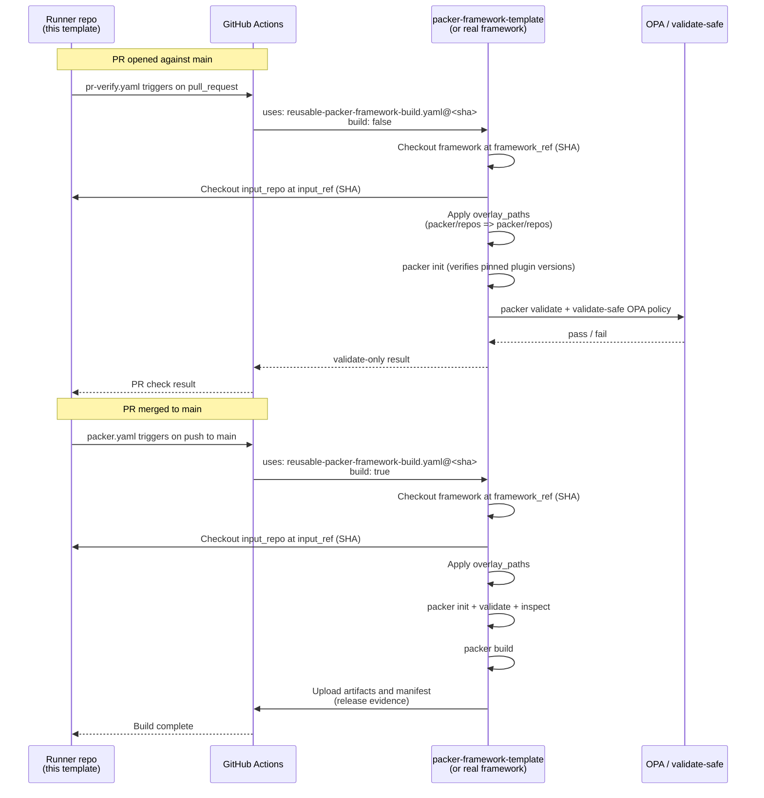

# packer-runner-template

[](https://github.com/NWarila/packer-runner-template/actions/workflows/ci.yaml)
[](https://github.com/NWarila/packer-runner-template/actions/workflows/repo-hygiene.yaml)
[](LICENSE)

A template for Packer repos that consume a framework: they own data (the inputs
that describe what to build) but not the Packer module itself. Use it to
scaffold a new Packer runner repo with CI, drift-gate, security workflows, and
release evidence already wired up.

The Packer runner model is intentionally thin — runners own inventory (var
files, install templates, build inputs), the framework reusable owns executable
build logic. The two are versioned independently and consumers pin to the
framework by 40-character SHA.

> Implements the data-only Packer runner pattern defined in
> [`packer-framework-template`
> ADR-0005](https://github.com/NWarila/packer-framework-template/blob/main/docs/decision-records/template/0005-define-data-only-packer-runner-repositories.md):
> the contract, caller workflows, drift-gate, repo-hygiene, and the
> contract-test fixture suite are wired up and enforced in CI.

## Quickstart

```sh
# 1. Create a new repo from this template on GitHub
#    (Use this template → Create a new repository)

# 2. Resolve the framework SHA you want to pin to
gh api repos/NWarila/packer-framework-template/commits/main --jq .sha

# 3. Update the framework SHA in both caller workflows
#    .github/workflows/packer.yaml
#    .github/workflows/pr-verify.yaml

# 4. Populate inventory
#    packer/repos/          — var files for images to build
#    packer/fixtures/runtime/ — runtime fixture data for the framework

# 5. Open a PR and verify the four CI gates go green:
#    contract · drift-gate · repo-hygiene · security
```

Full derivation walkthrough: [docs/how-to/derive-a-new-runner.md](docs/how-to/derive-a-new-runner.md).

## Architecture

Source: [docs/diagrams/runner-overlay-sequence.mmd](docs/diagrams/runner-overlay-sequence.mmd)



The three-layer stack this template sits in:

```text
┌─────────────────────────────────────────────────────┐
│ NWarila/.github                                     │
│   • org ADRs 0001-0010                              │
│   • CODE_OF_CONDUCT, CONTRIBUTING, SECURITY, ...    │
│   • org baseline-manifest.json                      │
└─────────────────┬───────────────────────────────────┘
                  │ drift-gate composite action
                  ▼
┌─────────────────────────────────────────────────────┐
│ NWarila/packer-runner-template  (THIS REPO)         │
│   • template ADRs (pinning, runner shape, ...)      │
│   • no local reusables (calls org reusables by SHA) │
│   • contract YAML + validator + harness + fixtures  │
│   • seed scaffold for runner repos                  │
└─────────────────┬───────────────────────────────────┘
                  │ uses: ...@<template-sha>
                  │ baseline-manifest.json drift-gate
                  ▼
┌─────────────────────────────────────────────────────┐
│ NWarila/<name>-packer-runner  (consumer)            │
│   • packer/repos/   ← inventory (data only)         │
│   • packer/fixtures/runtime/                        │
│   • .github/workflows/{packer,pr-verify,           │
│     drift-gate,security,release}.yaml               │
│   • docs/decision-records/repo/                     │
└─────────────────┬───────────────────────────────────┘
                  │ uses: ...@<framework-sha>
                  ▼
┌─────────────────────────────────────────────────────┐
│ NWarila/packer-framework-template  (reference) OR   │
│ nwarila-platform/<name>-packer-framework  (real)    │
│   • reusable-packer-framework-build.yaml            │
│   • packer/packer.pkr.hcl (CLI + plugin pins)       │
│   • packer/source.pkr.hcl, builds.pkr.hcl, ...     │
└─────────────────────────────────────────────────────┘
```

Full architecture detail: [docs/explanation/architecture.md](docs/explanation/architecture.md).

## Architecture Decision Records

| Tier | ADR | Summary |
|---|---|---|
| Org | [0001](docs/decision-records/org/0001-use-architecture-decision-records.md) | Use ADRs |
| Org | [0002](docs/decision-records/org/0002-adopt-diataxis-documentation-framework.md) | Diátaxis docs |
| Org | [0003](docs/decision-records/org/0003-use-deny-all-gitignore-strategy.md) | Deny-all .gitignore |
| Org | [0004](docs/decision-records/org/0004-use-renovate-for-dependency-updates.md) | Renovate for dependency updates |
| Org | [0010](docs/decision-records/org/0010-keep-ai-attribution-out-of-version-control.md) | No AI attribution in VCS |
| Template | [0001](docs/decision-records/template/0001-pin-packer-and-plugin-versions-exactly.md) | Exact Packer + plugin version pins |
| Repo | [0001](docs/decision-records/repo/0001-adopt-data-only-runner-shape.md) | Adopt data-only runner shape |

This template participates in the three-tier ADR model formalised in
[`NWarila/.github`
ADR-0001](https://github.com/NWarila/.github/blob/main/docs/decision-records/0001-use-architecture-decision-records.md):

- **Org tier** — ADRs apply to every repo regardless of stack. Mirrored
  byte-identical from [`NWarila/.github`](https://github.com/NWarila/.github).
  Drift-gated.
- **Template tier** — ADRs apply to every Packer-runner consumer derived from
  this template. Master copies live here.
- **Repo tier** — ADRs specific to one consumer repo, in that consumer's
  `docs/decision-records/repo/`.

## Reference

- [Runner protocol](docs/reference/runner-protocol.md) — caller signature,
  required inputs, overlay paths, pin management, and what the framework
  provides in return.
- [Quality gates](docs/reference/quality-gates.md) — full inventory of CI
  checks and what each validates.
- [Diagram conventions](docs/reference/diagram-conventions.md) — `.mmd` source
  file conventions for the portfolio.
- [How to derive a new runner](docs/how-to/derive-a-new-runner.md) — step by
  step from template to passing CI.

## Versioning

Conventional Commits + release-please. Consumers pin to commit SHAs (per the
same rule the contract enforces on them) and let Renovate carry pins forward.

## License

MIT — see [LICENSE](LICENSE).
